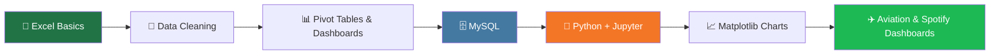

<div align="center">


<a href="https://github.com/devangxd-01">
  
</a>

<br/>


</div>

---

## 👋 About This Repository

A daily log of my **Data Analytics learning journey** as part of my IIoT training. Every file here is hands-on practice: formulas, pivot tables, dashboards, SQL queries and Python charts.

> *"Data is just numbers until you learn to ask it the right questions."*

---

## 🗺️ Learning Roadmap



---

## 🚀 15-Day Progress Log

<details open>
<summary><b>📗 Week 1: The Core Basics</b></summary>
<br/>

Started from a blank sheet creating student records. Quickly moved past manual calculations using `SUM`, `AVERAGE` and percentage formulas. Cleaned up the layout with `Ctrl + T` (Tables) and set up basic pass/fail logic using `COUNT`, `COUNTA` and `COUNTIF`.

</details>

<details open>
<summary><b>🧹 Week 2: Data Cleaning & Text Wrangling</b></summary>
<br/>

Experimented with `TODAY`, `NOW` and `RANDBETWEEN`, then used Conditional Formatting to spot trends at a glance. Spent a few days fixing noisy data: standardizing casing with `PROPER` / `UPPER`, stripping extra spaces with `TRIM`, and removing symbols with `SUBSTITUTE`. Ended the week merging and splitting full names using `TEXTJOIN`, `LEFT`, `RIGHT` and `FIND`.

</details>

<details open>
<summary><b>📊 Week 3: Dashboards & First Look at SQL</b></summary>
<br/>

Built a dynamic view using Pivot Tables, interactive Slicers and charts, bringing everything together into a clean student performance dashboard. On the final day, stepped outside Excel to write basic SQL queries (`CREATE`, `INSERT`, `SELECT`) to see how spreadsheets translate into relational databases.

</details>

---

## 📁 What's Inside

| Folder / File | Topic | Tools |
|---|---|---|
| `XL Day 1` to `XL Day 14` | Excel from basics to dashboards |  |
| `MySQL (Day 1)` | Database and table basics, first queries |  |
| `MySQL (Day 2)` | Filtering and working with data in SQL |  |
| `Sql connection with jupyter` | Connecting SQL to a Jupyter Notebook and running queries from Python |  |
| `Spotify_Dashboard.xlsx` | Spotify streaming dashboard with pivot-style summaries and charts |  |
| `Matplotlib charts (Jupyter)` | Line, bar, pie, histogram, scatter, box plot and subplots built one by one |  |

---

## ✈️ Featured Project: Aviation Dashboard

An interactive dashboard analysing airline customer data.

- 🎛️ Slicers for travel class (Business, Eco, Eco Plus) and arrival delay
- 👥 Loyal vs disloyal customers: flight distance comparison
- 🥧 Age distribution by gender and class
- ⏱️ Impact of departure delay on customer type
- 📈 Customer count and age trends across delay patterns

---

## 🎵 Featured Project: Spotify Dashboard

A Spotify-themed Excel dashboard built on Kaggle music data.

- 🟢 KPI cards: total tracks, total streams, average popularity, danceability and energy
- 📊 Charts: streams by genre, trend by release year, top 10 artists, explicit vs clean tracks
- 🧮 Pivot-style summary sheets that update automatically from the data sheet

---

## 🛠️ Skills Gained

<div align="center">

| 📗 Excel | 🗄️ SQL | 🐍 Python | 📊 Visualization |
|:---:|:---:|:---:|:---:|
| Formulas & functions | CREATE, INSERT, SELECT | Jupyter Notebook | Pivot Tables & Slicers |
| Data cleaning | Filtering & grouping | Pandas basics | Matplotlib charts |
| Conditional formatting | JOINs | SQL connection | Interactive dashboards |

</div>

---

## ⚙️ How to Use This Repo

```bash
# Clone the repository
git clone https://github.com/devangxd-01/Data_analytics_daily_task.git

# Open the folder
cd Data_analytics_daily_task

# For the notebooks
pip install pandas matplotlib jupyter
jupyter notebook
```

Excel files open directly in Microsoft Excel or Google Sheets.

---

## 🙏 Acknowledgement

Huge thanks to my mentor **Divyank Chauhan Sir** for the guidance and for teaching how to turn raw data into insights.

---

<div align="center">

### 👨‍💻 Devang Bhardwaj

[](https://github.com/devangxd-01)
[](https://www.linkedin.com/)

⭐ If you find this useful, consider giving the repo a star!


</div>
